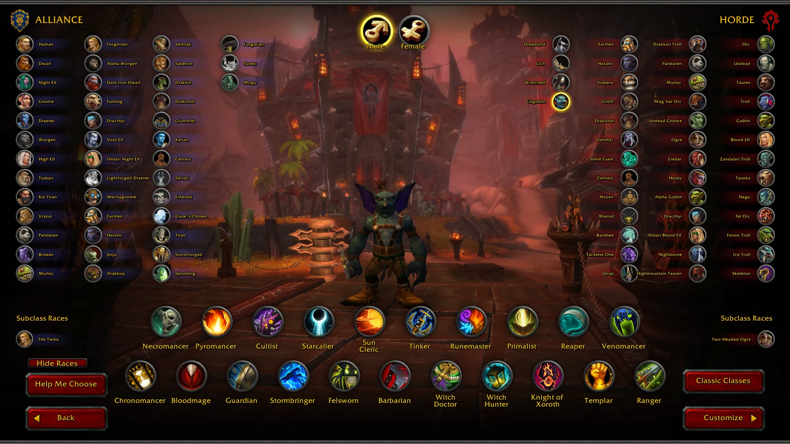

> **V2 is a full package. Download the release, extract, run the installer.** The source folders in this repo are for developers who want to
> port the races into their own AzerothCore; the playable package is on the [Releases page](../../releases).

# CoA Custom Races V2

Every custom race for Conquest of Azeroth (AzerothCore server + the CoA custom client), plus everything built since 1.9.9:
Gilgoblin, the restored Fading Island (boats, elevators, NPCs), Lumenveil graphics, retail mounts and pets, the in-game dev menu,
class incarnations and a lot of fixes.

**Video:** [docs/showcase.mp4](docs/showcase.mp4) (5 minutes, 1080p)

## Download
Releases page, **V2**: `CoA-Custom-V2-Server.zip` + `CoA-Custom-V2-Client-1..9.zip`. Extract all of them into one folder and run
`CoA-Custom\Install-Custom.bat`. Start the game with `CoACustomRace.exe`. Steps: [docs/INSTALL-GUIDE.txt](docs/INSTALL-GUIDE.txt).
Back up your characters first. What changed: [docs/PATCH-NOTES-V2.txt](docs/PATCH-NOTES-V2.txt).

## What is in V2
- **One client**: `CoACustomRace.exe`. Vulkan renderer with Lumenveil lighting / fog and the HD water and material passes.
- **80 race entries**, every id and credit in [RACES.md](RACES.md) and [docs/CoA-Custom-Races-V2-Credits.xlsx](docs/CoA-Custom-Races-V2-Credits.xlsx).
- **Gilgoblin** (the Unshackled, race 105) with racials.
- **Fading Island restore**: 2 boats (Booty Bay and Ratchet to Hardluck), 4 elevators, goblin passengers, spirit healer, teleports.
- **Retail mounts and pets**: about 1700 mounts, 2600 battle pets.
- **Dev menu**: `/dev` in-game editor for NPCs, items, quests, shops, paths and objects.
- **Incarnations**: every slot open to every class; Venomancer, Bloodmage, Reaper, Starcaller, Felsworn, Pyromancer, Necromancer,
  Cultist, Primalist, Tinker, Witch Hunter, Barbarian and Stormbringer forms and pets. See the release's `INCARNATIONS.md`.
- **Vanilla class health** matched to the CoA classes (levels 2 to 60).
- **Fixes**: Sylvari, Centaur and Faceless animations, Tuskarr ankle, white / green Saberon and Drakonid, bot freezes.

## Repo layout (developer resources)
| Folder | What |
|---|---|
| `client/models`, `client/textures` | race M2 models and BLP skins |
| `client/*.dbc`, `client/bins` | ChrRaces, CharSections, CreatureDisplayInfo, creator tables |
| `client/Interface` | creator Lua |
| `server/sql`, `server/dbc`, `server/core` | race SQL, server DBCs, racial C++ |
| `tools` | the python pipeline (animation, armour fit, racials generator, packing) |
| `docs` | install guide, patch notes, credits spreadsheet, racials |

Needs a custom worldserver (racials and incarnations are C++; the stock one does not have them).

## Credits
Read [CREDITS.md](CREDITS.md). Every race with its credit: [RACES.md](RACES.md).

The Lumenveil and HD graphics passes are GPL code built into the client; the client is based on a proprietary port by Sven Bledt
shared here with credit. Third-party assets keep their authors' terms.
